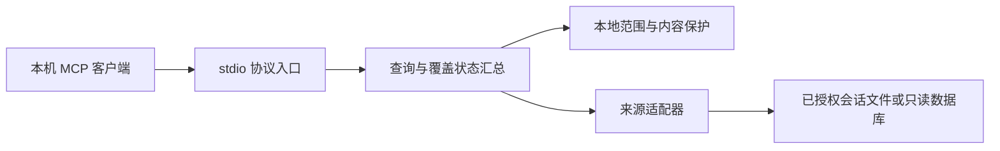

# 跨 Agent 会话检索 MCP 概要设计

状态：设计已由用户确认。需求依据：`02-产品需求文档.md`、`03-软件需求规格说明.md`。本轮以 Cursor Agent CLI 代码审查为主，辅以轻量测试；未覆盖项保持未验证。

## DES-ARCH-01：系统边界

本机 MCP 客户端通过 stdio 连接本项目进程；进程只扫描明确配置和启用的本地来源，将匹配结果和逐来源覆盖状态返回给客户端。首版不提供 HTTP 服务、远程同步、写入原会话、后台扫描和持久化索引。MCP 客户端收到的内容可能进入它所使用的模型或日志：**进程不主动联网不等于客户端或上游模型不会接收查询结果**；使用前必须确保查询范围和客户端符合数据权限。研发与审查过程只使用合成样本，不把真实会话正文交给外部模型。

数据流：请求校验 → 校验已批准的来源和项目范围 → 逐源受限读取和解析 → 时间、项目及关键词过滤 → 返回有界结果和覆盖状态。任何步骤未完成要标明不完整，不把部分扫描写成无结果。

## DES-ARCH-02：职责与依赖

| 组件 | 职责 | 拟定文件 | 合约 / 隐藏细节 | 依赖限制 |
|---|---|---|---|---|
| 协议入口 | 注册只读 MCP 工具，收发 stdio | `cross_agent_session_mcp/server.py` | 面向客户端的参数与结果契约；SDK 细节不泄露给适配器 | 可依赖查询协调层和 MCP SDK；不可直接访问会话存储 |
| 查询协调 | 校验查询、调度来源、汇总状态和分页 | `cross_agent_session_mcp/search.py`、`models.py` | 标准记录、覆盖状态和有界结果；隐藏各格式差异 | 依赖抽象和安全策略；不依赖具体目录布局 |
| 范围保护 | 白名单路径、项目范围、文本输出保护 | `cross_agent_session_mcp/policy.py` | 限定每次扫描和上下文读取的授权边界 | 不依赖协议层；不存在依靠目录名称证明硬隔离的声明 |
| 来源适配 | 逐源发现与读取消息、定位原文 | `cross_agent_session_mcp/sources/` 下各来源文件 | 输入受控来源配置，产出标准记录和完整性状态；隐藏路径、格式实现 | 单向依赖标准记录与安全策略；来源之间不相互依赖 |

文件映射为建议，允许执行者在保持职责、接口与范围不变的前提下调整；禁止引入自动同步或新的公共网络边界。实现后由审查核对实际导入、公共接口和依赖方向，不能只凭目录布局认定隔离。

## DES-ARCH-03：运行依赖和兼容

- 本机终端当前解释器为 Python 3.14.7，存在 MCP Python SDK 2.0.0 和标准库 `compression.zstd`；这是环境发现，并非服务已运行或可连接的证明。不同解释器的安装情况可能不同。
- 设计使用 Python 3.14 与已存在的 MCP SDK 2.x，经 stdio 暴露能力。不得为此安装新的 App、自动安装/更新依赖，或修改用户配置；缺失依赖时明确报错。
- DSH 读到多帧完整结束为要求；Python 文档指出单个 `ZstdDecompressor` 到一帧结束后需要处理 `unused_data`。最终方案必须在轻量测试中明确覆盖多帧，不以识别后缀证明解压正确。
- 借鉴 `agent-session-search` 的检索与 Cursor CLI 发现，以及 MIT 的 `agentctxsync` 读取设计；如复制 MIT 代码，保留来源、版权及许可证，剥离同步/写入逻辑并独立审查。无许可证的 DSH 插件只参考思路，不复制源码。

## DES-ARCH-04：来源映射与限制

| 来源 | 目标 | 固有限制 |
|---|---|---|
| Hermes | 当前 profile 的 `state.db` 会话与消息 | 实际 profile 与数据库路径受授权配置控制；数据库不可写 |
| DSH | `session.v4.jsonl.zstd` 等版本化事件流 | 完整多帧流、事件类型、时间字段须识别；无法解析要标部分或错误 |
| WorkBuddy GUI | `workbuddy.db` 的 sessions 与对应 JSONL | SQLite 毫秒时间、正文与索引关联；CLI 不从 GUI 空结果推断 |
| pi | 项目会话 JSONL | 项目及时间以可信元数据为准，不能猜中文编码目录 |
| Cursor Agent CLI | `agent-transcripts` 的 JSONL | 不用 Cursor IDE 数据假冒 CLI 会话；区分子代理记录 |
| Codex | sessions 与授权配置的归档 JSONL | 区分桌面和 CLI 的实际 originator；不把工具事件当用户消息 |

## DES-ARCH-05：失败、安全和恢复

- SQLite 采用只读 URI，明确锁定、WAL/SHM 状况或模式不兼容时返回失败，不以复制私有库或不可见降级绕过授权；不使用 `immutable=1` 对活动库伪称最新。
- 配置没有明确批准的授权范围时拒绝扫描；一个范围可以包含多个已批准项目，允许在该范围内跨项目检索。规范化并处理 Windows 大小写、symlink/junction 与路径逃逸。文件发现、上下文读取都执行同一边界。未知项目记录默认不返回正文，并计入覆盖说明。
- 输出数量、片段长度与扫描量有界；触发限制时返回截断与不完整标记。识别并遮蔽常见凭据形态，但不宣称能检测所有敏感信息。
- 不改现有应用配置和数据库，回滚仅停止此进程或移除已批准的独立项目；安装或接入 Hermes、变更配置、重启网关均未包含在本轮授权。
- 读取行为、六来源兼容性及安全保证均须以实际执行和审查结果确认；设计不是已验证事实。

## 关联决策

见 `../adr/001-本地只读检索.md`。ADR 已由用户确认。
